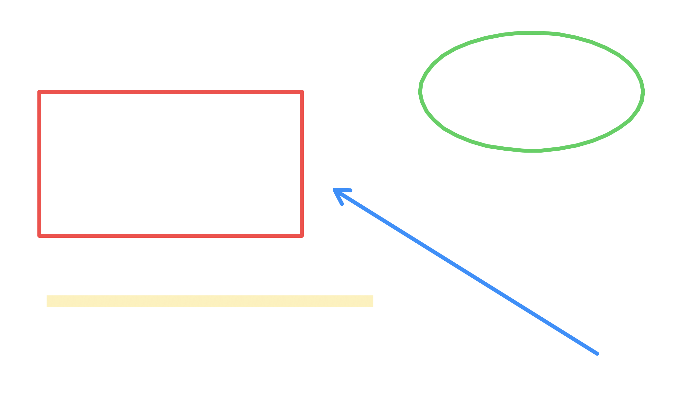
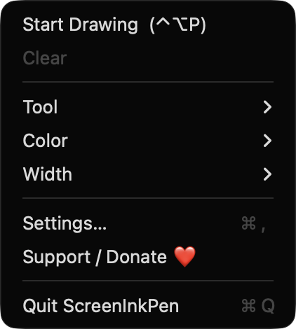
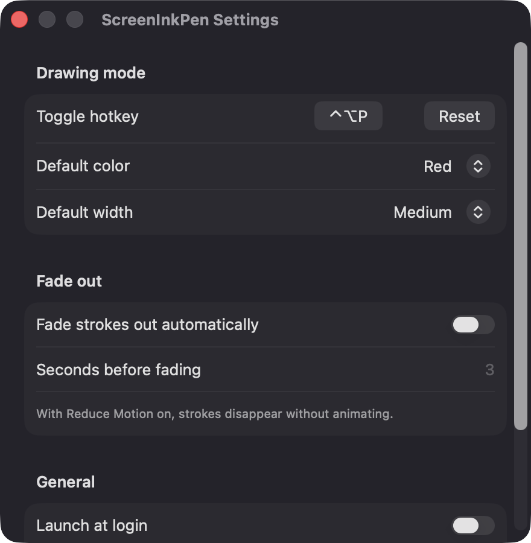

# ScreenInkPen

**🌐 Website:** [turhe123.github.io/screen-ink-pen](https://turhe123.github.io/screen-ink-pen/)

Draw arrows, boxes and freehand ink right on top of your screen during demos and calls, then wipe it clean.


## Why

ScreenInkPen is a free, open-source, 100% native, backend-free alternative to paid utilities in the *Presentation & Cursor* category. It was inspired by tools like Presentify ($7 one-time), which show how useful a light annotation layer is for teachers, streamers and anyone sharing their screen. ScreenInkPen aims at the same everyday job (point at things, circle things, then make it all disappear) with a small menu bar app you can read end to end.

## Features

- **Global hotkey** toggles drawing mode from any app (default `⌃⌥P`, rebindable in Settings with a click-to-record control).
- **Overlay on every display**: a transparent, borderless window per screen at screen-saver level, visible across Spaces and over full-screen apps. Overlays are rebuilt automatically when displays are added or removed.
- **Seven tools**: freehand pen, highlighter (translucent, multiply blending so text underneath stays readable), straight line, arrow, rectangle, ellipse and eraser.
- **Five preset colors** (red, yellow, green, blue, white) and **three stroke widths** (thin, medium, thick).
- **Undo / redo** (up to 200 steps), **clear all** with one key.
- **Optional fade-out**: strokes fade away after a configurable number of seconds. With macOS Reduce Motion on, they disappear without animating.
- **Floating toolbar** at the top center of the main display with tool buttons, color dots, width selector, undo, clear and stop. It is a non-activating panel, so it does not steal focus from the app you are presenting.
- **Menu bar app** (pencil icon): Start/Stop Drawing, Clear, Tool, Color and Width pickers, Settings, Support, Quit.
- **Launch at login** option (via `SMAppService`).
- **Smooth with lots of ink**: older strokes are flattened into a cached image once a display holds several hundred strokes.
- **First-run hint** in the toolbar ("Press P to start inking").

### Keyboard shortcuts (in drawing mode)

| Key | Action |
| --- | --- |
| `P` `H` `L` `A` `R` `O` `E` | Pen, Highlighter, Line, Arrow, Rectangle, Ellipse, Eraser |
| `1`–`5` | Red, Yellow, Green, Blue, White |
| `⌘Z` / `⇧⌘Z` | Undo / Redo |
| `Delete` | Clear all ink (stay in drawing mode) |
| `Esc` | Clear all ink and exit drawing mode |

The toolbar's ✕ button exits drawing mode but keeps the ink on screen.

## Screenshots

<p align="center"></p>

<p align="center"><em>Live annotations drawn on screen with ScreenInkPen: a red rectangle, a blue arrow, a green freehand circle and a yellow highlighter stroke.</em></p>

<p align="center"></p>

<p align="center"><em>The floating toolbar with seven drawing tools, five preset colors, a stroke width selector, undo, clear and stop.</em></p>

<p align="center"></p>

<p align="center"><em>The menu bar menu for starting drawing with ⌃⌥P and picking a tool, color and width.</em></p>

<p align="center"></p>

<p align="center"><em>Settings for the global hotkey, default color and width, automatic fade-out and launch at login.</em></p>

## Install

1. Download `ScreenInkPen-macOS.zip` from the [latest release](https://github.com/turhe123/screen-ink-pen/releases/latest).
2. Unzip it and move `ScreenInkPen.app` to `/Applications`.
3. Because the app is open source and not notarized, clear the quarantine flag:

   ```bash
   xattr -cr /Applications/ScreenInkPen.app
   ```

4. The first time, right-click the app and choose **Open**.

Requires macOS 14 (Sonoma) or later.

## Build from source

You need Xcode with the macOS SDK and [XcodeGen](https://github.com/yonaskolb/XcodeGen).

```bash
brew install xcodegen
xcodegen generate
xcodebuild -project ScreenInkPen.xcodeproj -scheme ScreenInkPen -configuration Release -derivedDataPath ./build build
```

The app lands at `build/Build/Products/Release/ScreenInkPen.app`.

## Permissions

ScreenInkPen asks for very little:

- **Accessibility: not required.** The global hotkey uses Carbon's `RegisterEventHotKey`, which does not need it.
- **Screen Recording: not required.** The app only draws its own transparent windows and never reads your screen's pixels.
- **Microphone, Camera, Contacts, etc.: not used.**
- **Login Items (optional).** If you turn on "Launch at login", macOS may show it under System Settings › General › Login Items.

Preferences (hotkey, default color/width, fade settings) are stored locally in `UserDefaults`.

## Built with AI

ScreenInkPen was written by [Claude Code](https://claude.com/claude-code) inside an automated pipeline, from a plain-English spec. No code, binaries or assets from any commercial app were used; it is a clean-room reimplementation of a feature set, not a copy.

What that means in practice:

- The full source is in this repo under the MIT license. Read it before you run it.
- No network calls, no analytics, no third-party dependencies. Only Apple frameworks.
- Ad-hoc signed and not notarized, which is why Gatekeeper warns on first launch.
- It has had less human review than a hand-written app. Bug reports and pull requests are welcome.

## Support ❤️

If ScreenInkPen is useful to you, you can support its development:

[Support Or (Leo) Davidai ❤️ on Ko-fi](https://ko-fi.com/leodavidai)

The app also has a "Support / Donate ❤️" button in its menu and Settings window.

## License

MIT © Or Davidai Bachar

## More free Mac apps

Prefer something that runs in the browser? The same pipeline builds [free, private web tools](https://turhe123.github.io/web-tools/): PDF, image, developer, data and audio tools, nothing uploaded.
